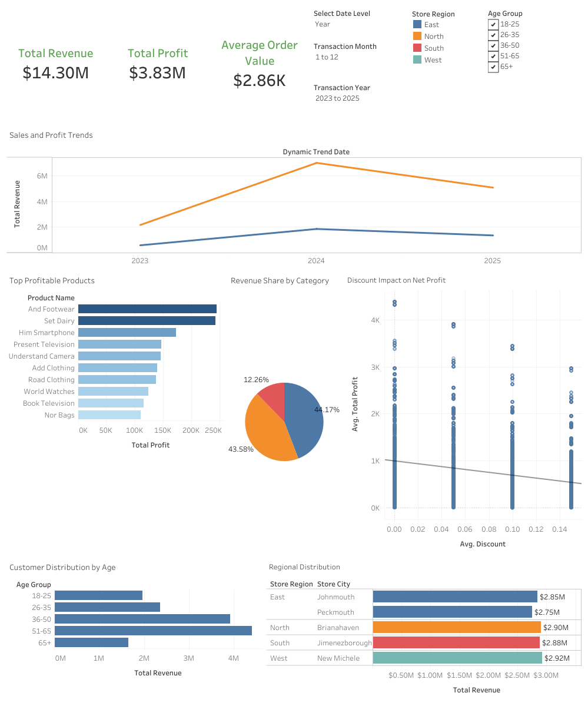
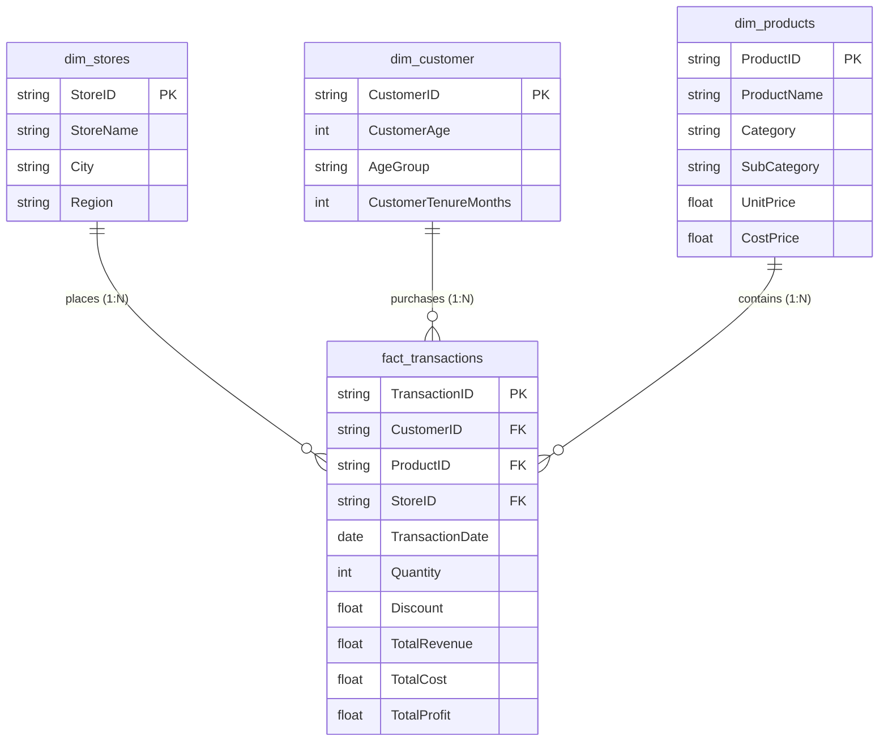

# Retail Sales Analytics & Enterprise Data Warehouse (MegaMart)

An end-to-end data analytics and business intelligence solution built using **Google BigQuery** and **Tableau**. This project models transactional retail records into a production-grade star schema, enforces data governance (PII minimization), and delivers executive-ready performance dashboards.

---

## 📊 Executive Dashboard Preview

> **Live Dashboard:** [View Interactive Tableau Dashboard](https://public.tableau.com/views/MegamartSalesPerformanceDashboard/Dashboard1?:language=en-US&:sid=&:redirect=auth&:display_count=n&:origin=viz_share_link)

---

## 📌 Executive Summary & Key Metrics

A reconciliation audit of the analytical reporting view (`vw_sales_reporting`) generated the following portfolio-wide baseline metrics:

| Key Performance Indicator | Value | Description |
| :--- | :--- | :--- |
| **Total Revenue** | **$14.30M** | Gross sales revenue realized after applied discounts |
| **Total Profit** | **$3.83M** | Gross operating profit across all lines |
| **Total Transactions** | **5,000** | Completed customer checkout transactions |
| **Active Customers** | **200** | Distinct purchasing customers across 4 retail regions |
| **Units Sold** | **14,949** | Physical retail merchandise units moved |
| **Overall Profit Margin** | **26.75%** | Aggregate portfolio gross margin |
| **Average Order Value (AOV)**| **$2,860.38** | Mean sales spend per customer transaction |

---
## 🏗️ Architecture & Data Modeling

The data warehouse implements a star schema optimized for retail analytical queries:

### 1. Dimension Tables
- **`dim_stores`**: Cleans raw headers and maps retail locations across East, North, South, and West regions.
- **`dim_customer`**: Implements **PII minimization** by omitting customer names and birth dates. Features calculated fields for `CustomerAge`, `CustomerTenureMonths`, and dynamic age cohort binning (`18–25`, `26–35`, `36–50`, `51–65`, `65+`) validated through quartile profiling.
- **`dim_products`**: Normalizes product categories, subcategories, unit costs, and retail prices.

### 2. Fact Table & Metrics Engine
- **`fact_transactions`**: Stores transaction records joined to product dimension pricing to compute line-level financial metrics:
  * $\text{Total Revenue} = \text{Quantity} \times \text{UnitPrice} \times (1 - \text{Discount})$
  * $\text{Total Cost} = \text{Quantity} \times \text{CostPrice}$
  * $\text{Total Profit} = \text{Total Revenue} - \text{Total Cost}$
  * $\text{Profit Per Unit} = (\text{UnitPrice} \times (1 - \text{Discount})) - \text{CostPrice}$

### 3. Reporting Layer
- **`vw_sales_reporting`**: A centralized, denormalized SQL view joining all dimensions with transactional measures, designed for optimal BI consumption in Tableau without complex runtime multi-table joins.

---

## 🔍 Data Quality Audits & Validation

Before dashboard deployment, the data warehouse was validated via rigorous BigQuery SQL audit scripts:
- **Duplicate Detection:** Confirmed zero primary key collisions across `dim_stores`, `dim_products`, `dim_customer`, and `fact_transactions`.
- **Missing Value Audits:** Audited all columns with `COUNTIF(column IS NULL)`; confirmed 0 null values in transactional measures, foreign keys, or dates.
- **Referential Integrity:** Validated zero orphan records (`LEFT JOIN` checks returning 0 unlinked foreign keys).

---

## 📈 Strategic Business Insights

- **Demographic Performance:** Customers aged 36–65 represent over **57%** of total transaction volume and drive the bulk of revenue, highlighting mature demographics as the highest-yield segment.
- **Regional Performance:** The **East** region leads overall sales at **$5.60M** across its two store locations (Johnmouth at $2.85M and Peckmouth at $2.75M), followed by balanced, consistent contributions from single-store markets in the **West** ($2.92M), **North** ($2.90M), and **South** ($2.88M).
- **Discount vs. Profit Sensitivity:** Analysis demonstrates an inverse relationship between discount depth and net profit margins, indicating aggressive discounting above 10% erodes gross profitability without proportional volume gains.

---

## 📁 Repository Deliverables

- 📜 **[retail_sales_bigquery_pipeline.sql](retail_sales_bigquery_pipeline.sql):** Complete BigQuery DDL, ETL transformation queries, data cleaning audits, and reporting views.
- 📄 **[Report Part 2.pdf](Report.pdf):** Technical ETL execution, validation methodology, and SQL profiling report.
- 📄 **Part 1 Requirements Documentation:** Stakeholder requirements matrix, project scoping, and strategic objectives.

---

## 👩‍💻 Author

**Hasna Ait Boui**  
*Data & Operations Analyst*  
[LinkedIn Profile](https://www.linkedin.com/in/hasna-ait-boui-742a89266)

